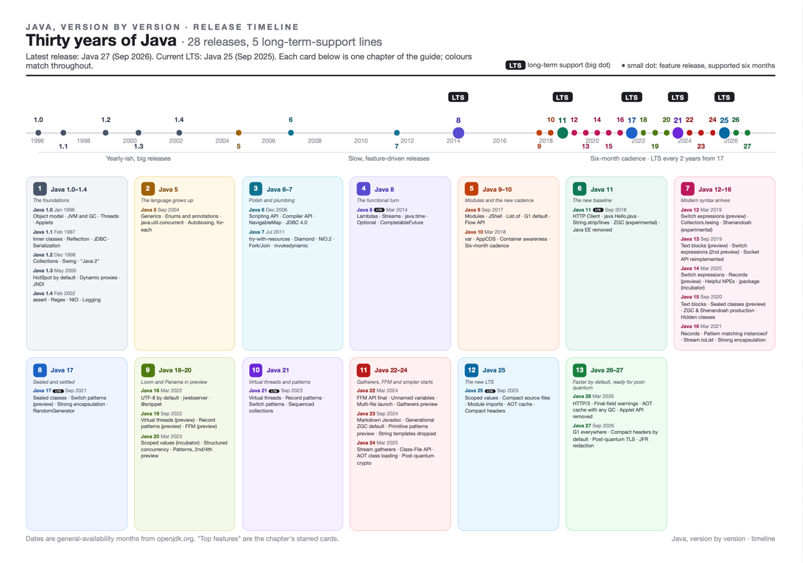

# Java features by version

## Why this exists

I kept forgetting which Java version brought what. Every time I looked it up I read the same documents again and forgot them again a month later.

So I started writing the answers down in a form I would actually come back to, one page per release that fits on
the desk, a graph that shows how the features hang together and a longer guide for the days when one line is not
enough.

It is for those of us who already know Java and want to refresh our memory fast. It is not a tutorial and it does
not replace the specification. It is what we open when we move a project from Java 8 to 21, prepare for an
interview, review a pull request written in syntax we have never typed ourselves or want to know what changed in
the release that came out recently.

Everything is an A4 PDF. It prints well for those of us who like paper but it reads just as well on a tablet or a
second screen. 🌳 If we must print something, the cheat sheet is the one page worth the paper. The rest can stay
digital.

## What is inside

Each Java version, or small group of minor releases, has its own folder under `java-versions/` with three documents.
The next section says which one to open for which question.

| Document | What it is |
|---|---|
| Knowledge graph | One landscape page. On the left, what Java already had. In the middle, the version's features grouped by the job they do. On the right, what they made possible later. Arrows are labelled *needs*, *enables*, *extends*, *improves*, *replaces*, *pairs with*. |
| Guide | One card per feature: a plain-language explanation, a short code example, *Use it when*, *Do*, *Don't*, *Remember*. Then an in-depth section, why the feature exists, something to try at the keyboard and references to the primary sources (JEP, JSR, specification or API page). Ends with a Dos & Don'ts table and a *Don't mix these up* box. |
| Cheat sheet | One page. Every feature of the release in a line with a code fragment, the headline Do/Don'ts and the pairs of concepts people confuse. |

The root of the repository holds the material that spans all versions.

| Document | What it is |
|---|---|
| `java-release-timeline.pdf` | Every release since 1996 on one axis: dates, the long-term-support lines, the switch from feature-driven releases to the six-month cadence and each version's headline features. |
| `java-evolution-tracks.pdf` | One row per big idea (syntax, type system, pattern matching, functional programming, collections, concurrency, runtime and GC, platform and tooling, native access, security), one column per version. Read a row to follow an idea from its first preview to its final form. |
| `java-knowledge-graphs.pdf` | All knowledge graphs in one file. |
| `java-cheat-sheets.pdf` | All cheat sheets in one file, one page each. |

## How to use it as a quick reference

What did version X add? Open `java-versions/java-X/cheat-sheet.pdf`. Sixteen or so lines, one minute.

How does feature Y work again and what is the catch? Find Y's number on the cheat sheet and open the same number in
`guide.pdf`. The *Don't* line and the *Don't mix these up* box are where most bugs hide.

We are upgrading from version A to version B. Read the cheat sheets for every version in between, in order, then the
evolution tracks poster to see which previews became final along the way.

When did Java get Z? The release timeline, or the *since* line on Z's card, which names the version and the JEP.

Is this feature final, preview or incubating? Every card and every cheat-sheet line carries a status tag. Preview and
incubator features can change between releases and the card's *since* line records which rounds a feature went
through before it settled.

## Conventions

Features are grouped by the job they do. A handful of small groups is easier to remember than one
long list and it is how we think about them when we are actually writing code.

Each card names its source in the *since* line: the Java version and the JEP or JSR that introduced it. For features
older than the JEP process, the Java Language Specification or JVM Specification chapter is given instead.

Status tags are final (no tag), preview, incubator, experimental, deprecated, removed and withdrawn.

Code examples are short on purpose. They show the shape of a feature, not a complete program.

If you do print: A4, scale 100% ("actual size"), colour, background graphics on. 

## Coverage

| Folder | Releases | Theme |
|---|---|---|
| `java-1.0-1.4` | 1.0 to 1.4 (1996 to 2002) | The foundations: object model, JVM, GC, threads, collections, reflection, NIO |
| `java-5` | 5 (2004) | The language grows up: generics, enums, annotations, `java.util.concurrent` |
| `java-6-7` | 6 and 7 (2006, 2011) | Polish and plumbing: try-with-resources, NIO.2, fork/join, invokedynamic |
| `java-8` | 8 (2014, LTS) | The functional turn: lambdas, streams, `java.time`, `Optional` |
| `java-9-10` | 9 and 10 (2017, 2018) | Modules and the new cadence: JPMS, JShell, `var` |
| `java-11` | 11 (2018, LTS) | The new baseline: HTTP client, single-file launch, Java EE removed |
| `java-12-16` | 12 to 16 (2019 to 2021) | Modern syntax arrives: switch expressions, text blocks, records, pattern matching |
| `java-17` | 17 (2021, LTS) | Sealed and settled: sealed types, strong encapsulation |
| `java-18-20` | 18 to 20 (2022, 2023) | Loom and Panama in preview: virtual threads, FFM, record patterns |
| `java-21` | 21 (2023, LTS) | Virtual threads and patterns: virtual threads, switch patterns, sequenced collections |
| `java-22-24` | 22 to 24 (2024, 2025) | Gatherers, FFM and simpler starts |
| `java-25` | 25 (2025, LTS) | The new LTS: scoped values, compact source files, AOT cache |
| `java-26-27` | 26 and 27 (2026) | Faster by default, ready for post-quantum: HTTP/3, G1 everywhere, hybrid TLS |

Folders appear as I finish reviewing them, so a version missing from `java-versions/` is on its way rather than
skipped. New releases get added after each March and September JDK release.

## Sources

Feature names, JEP and JSR numbers and release dates come from the OpenJDK project pages and JEP index
(openjdk.org), the Java Community Process (jcp.org), the Java Language Specification and Java Virtual Machine
Specification (docs.oracle.com/javase/specs), the JDK API documentation and the JDK release notes. The guides'
*References* sections point to the specific pages. Explanations, examples and advice are my own wording, drafted
together with my AI agent. So are any mistakes.

Found one? Open an issue with the version, the card number and the correction. Pull requests are welcome too.

## Human-AI collaboration

I did not write this alone. An AI agent (Claude, by Anthropic) did the first drafts, built the knowledge graphs,
laid out the pages and chased JEP numbers across openjdk.org while I asked the questions, argued with the answers,
cut what was wrong and rewrote what was unclear. Every page went through at least one round of "I don't understand
this, explain it properly" before it landed here. Facts were checked against the sources above. Where a claim could
not be traced to one, it was dropped.

If something still reads like a machine wrote it, that is on me for not catching it. If something reads like a
person wrote it, that was usually a machine's third or tenth attempt.

> Until AI brings about human extinction, we can work shoulder to shoulder building cool stuff 🤝

## Licence

This work is licensed under the Creative Commons Attribution 4.0 International licence (CC BY 4.0). You may copy,
share and adapt it, including for commercial use, as long as you credit the source: *Kamal Abdullayev, Java features
by version*, with a link to this repository. Contributions are accepted under the same licence.

Java is a registered trademark of Oracle and/or its affiliates. This is an independent study resource, not affiliated
with or endorsed by Oracle.
